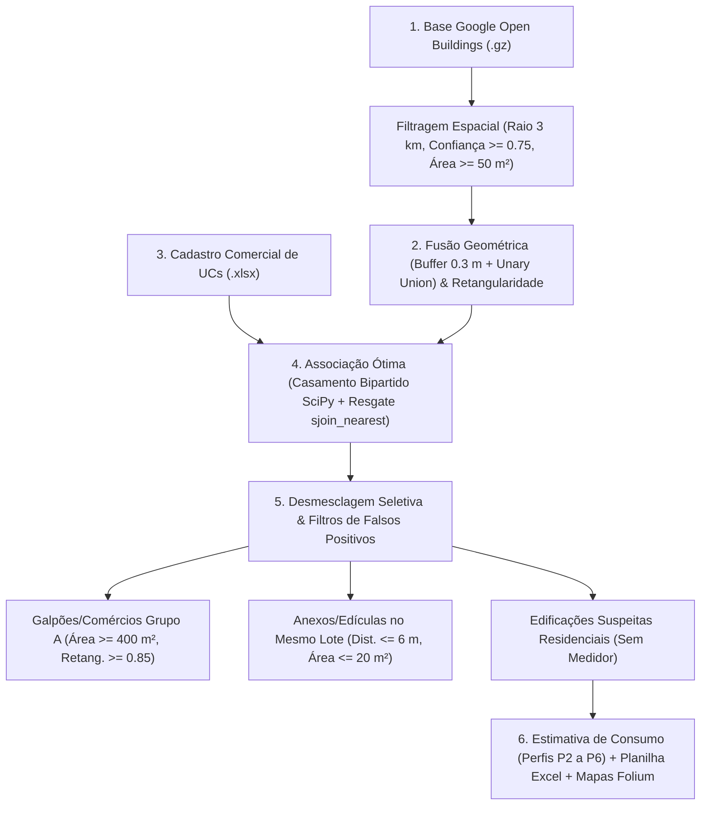

# ⚡ Identificação e Estimativa de Perdas Não Técnicas (PNT) via Google Open Buildings

[](https://www.python.org/)
[](https://geopandas.org/)
[](https://scipy.org/)
[](https://shapely.readthedocs.io/)
[](https://python-visualization.github.io/folium/)
[](https://www.fee.unicamp.br/)

> **Projeto de Iniciação Científica — Faculdade de Engenharia Elétrica e de Computação (FEEC / UNICAMP)**  
> **Autor:** João Henrique Vianini Teixeira  
> **Orientadora:** Profa. Dra. Fernanda Caseño Trindade Arioli

---

## 📌 Visão Geral

Este repositório contém o código-fonte principal (`metodologia1_comparativa.py`) desenvolvido para a **detecção geoespacial de conexões clandestinas** e **estimativa de Perdas Não Técnicas (PNT)** em redes de distribuição de energia elétrica de baixa tensão.

A metodologia cruza os *footprints* de edificações detectados por aprendizado profundo via satélite (**Google Open Buildings**) com a base georreferenciada de **Unidades Consumidoras (UCs)** da concessionária local, aplicando **otimização combinatória (casamento bipartido de peso mínimo)** e **filtros morfológicos** para isolar residências potencialmente não faturadas e quantificar o impacto energético ($\text{kWh}$) e financeiro ($\text{R\$}$).

---

## 🧠 Arquitetura do Algoritmo (`metodologia1_comparativa.py`)

O pipeline completo é executado em **6 etapas sequenciais**, comparando simultaneamente dois cenários físicos de alcance do ramal de ligação (**30 metros** — padrão aéreo e **45 metros** — alcance estendido/subterrâneo):



---

### Etapa 1 — Extração e Filtragem Geoespacial (Open Buildings)
- **Leitura em lotes (*Chunking*):** Processa o arquivo compactado `OpBuildingCPS.gz` em blocos de `200.000` linhas com tipagem reduzida (`float32`), preservando memória RAM.
- **Recorte métrico:** Projeta os dados do sistema geodésico `EPSG:4326` (WGS 84) para a projeção plana métrica **`EPSG:31983` (SIRGAS 2000 / UTM Zone 23S)**, recortando um raio exato de **3 km** ao redor do centro da região de estudo.
- **Critérios de qualidade:** Mantém apenas polígonos com confiança do modelo neuronal $\ge 0,75$ e área construída $\ge 50\text{ m}^2$, eliminando ruídos de segmentação.

### Etapa 2 — Mesclagem Morfológica e Índice de Retangularidade
- **Fusão de telhados contíguos:** Aplica uma expansão morfológica (`buffer = 0.3 m`) seguida de `unary_union` para agrupar águas de telhado pertencentes a uma mesma estrutura física.
- **Geometria envolvente:** Calcula o círculo mínimo envolvente (`shapely.minimum_bounding_circle`) e o **Índice de Retangularidade** proposto por Rosin (1999):

$$\text{Retangularidade} = \frac{\text{Área}(\text{Polígono})}{\text{Área}(\text{Retângulo Mínimo Rotacionado})} \in (0, 1]$$

### Etapa 3 — Processamento do Cadastro Comercial de UCs
- Converte as coordenadas WKT das Unidades Consumidoras para `EPSG:31983` e filtra os medidores situados dentro do raio de 3 km.
- Extrai dinamicamente a **mediana empírica local de consumo residencial** (classes `RE1` e `RE2` com faturamento positivo), utilizada como cenário central de referência (**Perfil P6**).

### Etapa 4 — Associação Combinatória Ótima (Medidores $\leftrightarrow$ Edificações)
A vinculação entre medidores e edificações na função `executar_associacao()` respeita o comprimento máximo do cabo de serviço ($d_{\max} \in \{30\text{ m}, 45\text{ m}\}$):
1. **Fase A — Casamento Bipartido de Peso Mínimo (`min_weight_full_bipartite_matching`):** Constrói uma matriz esparsa `csr_matrix` de distâncias euclidianas entre edificações e UCs candidatas, resolvendo o problema de atribuição retangular 2D (Crouse, 2016) para maximizar o número de edificações atendidas com a menor soma global de comprimentos de cabo.
2. **Fase B — Múltiplos Medidores:** Associa UCs remanescentes (ex.: prédios ou lotes multifamiliares) à edificação válida mais próxima.
3. **Resgate de UCs Órfãs (`sjoin_nearest`):** Medidores não vinculados ao centroide são testados contra a borda real do polígono da edificação dentro do limite $d_{\max}$.

### Etapa 5 — Desmesclagem Seletiva e Mitigação de Falsos Positivos
Para evitar superestimação de perdas comerciais:
- **Desmesclagem seletiva:** Agrupamentos classificados inicialmente como *sem medidor* que continham múltiplos polígonos são desmembrados de volta aos seus polígonos originais para inspeção individual.
- **Filtro de Galpões e Comércios (Grupo A / Média Tensão):** Edificações sem medidor de baixa tensão com $\text{Área} \ge 400\text{ m}^2$ e $\text{Retangularidade} \ge 0,85$ são classificadas como `NAO RESIDENCIAL (GALPAO/COMERCIO)` para verificação em Média Tensão, sem atribuição de perdas residenciais fictícias.
- **Filtro de Anexos e Edículas (Res. ANEEL nº 1.000/2021):** Construções secundárias sem medidor próprio situadas a até **6 metros** de uma edificação regular com medidor e com área $\le 20\text{ m}^2$ são identificadas como `ANEXO / EDICULA (COM MEDIDOR)` e isentas da contabilização de fraude.

### Etapa 6 — Perfis de Estimativa de Consumo (P2 a P6)
Para cada edificação classificada como **Suspeita Residencial**, o impacto energético mensal/anual e financeiro (tarifa média $\text{R\$ } 0,95/\text{kWh}$) é avaliado sob cinco perfis fundamentados na literatura:

| Perfil | Descrição | Consumo Estimado ($\text{kWh/mês}$) | Fundamentação / Fonte |
| :--- | :--- | :---: | :--- |
| **P2 (Verão)** | Sazonalidade de Verão | `460,00` | Silva (2025) — Dissertação FEEC/UNICAMP |
| **P2 (Inverno)** | Sazonalidade de Inverno | `190,00` | Silva (2025) — Dissertação FEEC/UNICAMP |
| **P3 (Próprio)** | Modelagem *Bottom-Up* de Equipamentos Essenciais | `105,77` | Tabelas de Eficiência Energética PBE/INMETRO |
| **P4 (Sudeste)** | Média Residencial — Região Sudeste | `174,06` | Geraldi et al. (2022) / EPE / PROCEL ($2.088,7\text{ kWh/ano}$) |
| **P5 (Baixa Renda)** | Média Residencial Baixa Renda — Sudeste | `153,66` | Geraldi et al. (2022) / EPE / PROCEL ($1.843,9\text{ kWh/ano}$) |
| **P6 (Mediana Local)** | **Cenário Central:** Mediana Empírica do Bairro | `~168,00` | Calculada diretamente das UCs regulares na área de estudo |

---

## 🚀 Como Executar

### 1. Pré-requisitos e Instalação
Certifique-se de ter o **Python 3.10+** instalado e instale as dependências científicas:

```bash
pip install pandas geopandas shapely scipy folium openpyxl numpy
```

### 2. Arquivos de Entrada Esperados
Coloque os arquivos de entrada na pasta `Arquivos/` (ignorada no versionamento por conter dados brutos volumosos/sensíveis):
- `Arquivos/OpBuildingCPS.gz` — Base de polígonos do Google Open Buildings da região.
- `Arquivos/lista_ucs_fernanda_joao.xlsx` — Base anonimizada de UCs contendo as colunas `Código ID`, `Classe`, `Consumo Mensal` e `Coordenada` (WKT).

### 3. Execução do Script Principal
```bash
python metodologia1_comparativa.py
```

### 4. Resultados Gerados Automaticamente
- 📊 **`m1_comparativo_30m_vs_45m.xlsx`**: Planilha executiva contendo 9 abas (`comparacao_30m_vs_45m`, `resumo_perdas_30m`, `resumo_perdas_45m`, `suspeitas_30m`, `suspeitas_45m`, `anexos_30m`, `anexos_45m`, `galpoes_grupo_a`, `ucs_orfas_30m` e `ucs_orfas_45m`).
- 🗺️ **`metodologia1_cabo30m.html` & `metodologia1_cabo45m.html`**: Mapas interativos em Folium com camadas de satélite (Esri World Imagery), contornos dos telhados, clusters de edificações codificados por cor e *tooltips* detalhados por unidade.

---

## 📚 Referências Bibliográficas

1. **NORTHEAST GROUP.** *Electricity theft and non-technical losses: quantifying the non-technical loss problem*. [S. l.: s. n.], 2021. Disponível em: <https://northeastgroup.com/2021/10/20/electricity-theft-non-technical-losses>.
2. **GOOGLE RESEARCH.** *Open Buildings*. Disponível em: <https://sites.research.google/gr/open-buildings/>.
3. **SIRKO, W. et al.** Continental-scale building detection at high resolution with deep learning. *arXiv:2107.13078*, 2021. Disponível em: <https://arxiv.org/abs/2107.13078>.
4. **VIRTANEN, P. et al.** SciPy 1.0: Fundamental Algorithms for Scientific Computing in Python. *Nature Methods*, v. 17, p. 261–272, 2020. DOI: [10.1038/s41592-019-0686-2](https://doi.org/10.1038/s41592-019-0686-2).
5. **CROUSE, D. F.** On implementing 2D rectangular assignment algorithms. *IEEE Transactions on Aerospace and Electronic Systems*, v. 52, n. 4, p. 1679–1696, ago. 2016. DOI: [10.1109/TAES.2016.140952](https://doi.org/10.1109/TAES.2016.140952).
6. **ROSIN, P. L.** Measuring rectangularity. *Machine Vision and Applications*, v. 11, n. 4, p. 191–196, 1999.
7. **SILVA, Nelson Rodrigues.** *Potenciais aplicações da visão computacional e ortoimagens para otimizar processos essenciais na distribuição de energia elétrica*. Orientadora: Fernanda Caseño Trindade Arioli. 2025. 84 f. Dissertação (Mestrado em Engenharia Elétrica) – FEEC, Universidade Estadual de Campinas (UNICAMP), Campinas, 2025.
8. **CARDOSO, André Luiz Martins.** *Estimativa de perdas não técnicas de áreas em vulnerabilidade social e proposição de mitigação com base no marco legal da microgeração e minigeração distribuída*. Orientador: Lúcio Renê Prade. 2023. 96 f. TCC (Graduação em Engenharia Elétrica) – UNISINOS, São Leopoldo, 2023.
9. **ELETROBRAS.** *PPH 2019: Programa de Performance Humana*. Rio de Janeiro: Eletrobras, 2019. Disponível em: <https://eletrobras.com/pt/Paginas/PPH-2019.aspx>.
10. **GERALDI, Matheus et al.** Análise longitudinal do consumo de energia elétrica do setor residencial no Brasil. In: *ENCONTRO NACIONAL DE TECNOLOGIA DO AMBIENTE CONSTRUÍDO (ENTAC)*, 19., 2022, Canela. Anais [...]. Porto Alegre: ANTAC, 2022. v. 19, n. 1, p. 1–14. DOI: [10.46421/entac.v19i1.2005](https://doi.org/10.46421/entac.v19i1.2005).
